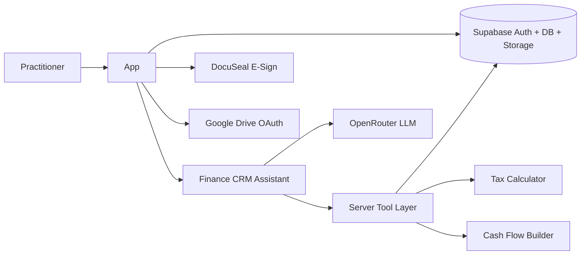

Hey there,

This one’s a bit different from the usual “why CRM templates” posts.

We recently shipped a **Finance CRM** for a client in Australia — bookkeepers, tax agents, and small business advisers on their side. I’m not going to name the practice, share private screenshots of their data, or walk through their commercial terms. That’s their business.

What I *can* talk about is the problem we solved, how the product fits real accounting workflows, and — honestly — how much faster this went because we weren’t starting from a blank Next.js repo.

We’ve also sold **12 copies** of the SaaS CRM React template on Gumroad so far. Proof lives on the product page itself: [SaaS CRM React Template on Gumroad](https://shreyvijayvargiya.gumroad.com/l/saas-crm-react-template). That’s the same foundation we keep extending for client work like this.

---

## Why this product needed to exist

Most accounting practices still run client work across a patchwork: a spreadsheet for budgets, a PDF tool for tax output, a separate e-sign platform, and a shared Drive folder for finals. Every handoff costs time, introduces typos, and leaves clients juggling three links and a “which version is final?” thread.

The brief (paraphrased) was simple: **one calm workspace** that connects the steps practitioners already run — budget planning → ATO-oriented PDF → embedded signing → secure document storage — without pretending to replace Google Sheets entirely. Sheets stays useful for import/export. The **calculation surface** lives inside the CRM.

That’s the product we built with them.

---

## How SaaSCRM helped us ship it

This is the part founders usually skip in case studies.

We didn’t invent “contacts, documents, settings, auth-shaped pages” from scratch. **[SaaSCRM](https://saascrm.site)** (and the template we sell) already gives you the boring-but-critical skeleton:

- Auth-ready app shell and dashboard patterns  
- Entity list/detail UX you can extend (clients, vendors, documents)  
- CMS / settings / storage-shaped modules to clone from  
- A place to hang AI tools without bolting a random chatbot onto a marketing site  

For the Australian build, that meant we spent the weeks on **domain work** — budget grid semantics, tax PDF structure, DocuSeal embed flows, bank-statement extraction, Drive OAuth per user — instead of re-debating sidebar layout for the twentieth time.

If you’re evaluating whether a template is “worth it,” this is the test: did it free you to ship the part only *your* client needs? For us, yes.

---

## Features that map to real workflows

Every feature maps to a step in client engagement:

| Stage | What you do | Where it lives |
| --- | --- | --- |
| Plan | Capture income, expenses, and net position | Budget Planner |
| Prepare | Generate structured ATO-oriented PDF | Budget toolbar → PDF builder |
| Sign | Collect client signature in-app | DocuSeal embed |
| Store | Save to library + optional Drive backup | Documents |
| Analyse | Upload bank statements, review cash flow | Bank Statements |
| Manage | Track clients and vendors | Payees |

### Budget planner

A spreadsheet-style grid built for small business accounting. Annual Income, Tax Withheld, GST Owed, BAS Amount, Net Income, plus custom categories. CSV import/export from the toolbar so nobody re-keys figures on the way to PDF.

### ATO-oriented tax PDFs

Generate structured tax return PDFs from budget data and taxpayer details. Because the numbers live in one workspace, the PDF reflects what you already reviewed in the grid — not a stale export from last Tuesday.

### E-signing with DocuSeal

Embedded signing keeps clients inside a branded flow. Completed PDFs land in the document library and can sync to Google Drive.

### Bank statements

Upload PDF statements; AI extracts transactions. Review, edit, import CSV, export to Excel or PDF, optionally sync rows to Google Sheets.

### Secure document storage

Private storage per account, with optional **PIN-protected links** when sharing PDFs externally. Clients get a controlled view — not the full practitioner workspace.

### Google Drive backup

Connect a Google account once in Settings. Signed PDFs sync into a dedicated folder on **their** Drive quota — not a shared service account with mystery limits.

### Payee management

Create and manage clients and vendors from Payees, or through the AI assistant when that’s faster.

---

## The stack (what we actually used)

We kept the stack modern and type-safe so server and client stay close:

| Layer | Technology |
| --- | --- |
| Framework | TanStack Start + React 19 |
| Build & SSR | Vite + Nitro |
| Language | TypeScript |
| Styling | Tailwind CSS + Radix UI |
| Database & auth | Supabase (Postgres, Auth, Storage) |
| Data fetching | TanStack Query + TanStack Router |
| E-signing | DocuSeal API (embedded) |
| Google | OAuth 2.0 per user (`googleapis`) |
| PDF | `@react-pdf/renderer` + `pdf-lib` |
| Spreadsheet UI | Silevis ReactGrid |
| Uploads | Better Upload + Supabase Storage |
| AI | OpenRouter (chat + tool calling) |
| Tests | Vitest |
| Host | Vercel |

### Why this stack?

- **TanStack Start** — file-based routing, server functions, SSR without splitting a second backend repo.  
- **Supabase** — auth, RLS, document storage so each practice gets an isolated workspace.  
- **TypeScript end-to-end** — budget rows, payees, and AI tool schemas stay consistent.  
- **OpenRouter** — swap models via env without rewriting the assistant layer.

One codebase: marketing pages, authenticated dashboard, server-side PDF rendering, and an agent that can read/write workspace data through typed tools.

---

## The AI agent (not a bolted-on chatbot)

The assistant lives on the dashboard and in an app-wide sidebar. It’s wired to the same data the team already uses.

Traditional “CRM AI” answers generic questions. This one can **act**:

- Run Australian GST and income-tax calculations with full bracket tables  
- Turn P&L profit into a saved budget spreadsheet from one prompt  
- Build cash-flow statements from uploaded bank statements  
- Create, update, list, and delete payees  
- Summarise documents and recent workspace activity  
- Guide users through e-sign, Drive setup, and PDF flows with in-app links  

Calculations use **deterministic server-side tools** — the model doesn’t invent tax figures.

### Tools at a glance

| Tool | What it does |
| --- | --- |
| `calculate_tax` | GST (10%), GST-inclusive breakdown, 2024–25 resident income-tax estimates |
| `estimate_tax_and_save_budget` | P&L → tax rows written into the Budget Planner |
| `apply_budget_rows` | Create or update a budget with custom line items |
| `summarize_bank_cashflow` | Operating inflows/outflows, net movement, balances |
| `list_bank_statements` | List saved statements for the signed-in user |
| Payee tools | CRUD for clients/vendors |
| Document tools | Recent documents and workspace summaries |

After each tool run, the UI gets structured markdown (bracket tables, cash-flow statements) plus deep links to the right page.

### Prompts people actually use

- *“Estimate Australian income tax on $70,000. Show the full bracket table, effective rate, and take-home pay.”*  
- *“Treat $70,000 as annual P&L profit. Estimate income tax, write it into my budget spreadsheet, and give me the link.”*  
- *“Build a cash-flow statement from my latest bank statement.”*  
- *“Create payee Acme Accounting with email billing@acme.com.au”*

Bank PDF extraction is a separate OpenRouter pipeline on upload. Voice input/output is available for reviewing numbers away from the keyboard.

Some actions stay in the UI on purpose — PDF generation, DocuSeal signing, Drive OAuth, PIN sharing. The assistant explains the steps and links out instead of pretending it clicked the buttons.

> **Note:** Tax figures from the assistant are **estimates**, not legal or tax advice. Always verify before filing.

---

## Architecture in one picture

The LLM handles language and orchestration. Numbers come from typed TypeScript functions against the authenticated workspace.

---

## Who it’s for

- Sole practitioners who want budget → PDF → sign → store in one place  
- Bookkeepers managing multiple small business clients  
- Tax agents preparing ATO-oriented output from consistent figures  
- Advisers who need cash-flow visibility from bank statements without five exports  

Pricing and packaging for that product live with the client’s go-to-market — not something I’m republishing here.

---

## What’s next on their roadmap

Phase 2 ideas we’ve already talked through: client messaging, invoicing, and multi-user team workspaces. The assistant is already aware of those concepts so it can guide users when those land.

---

## If you’re building something similar

You don’t need an Australian tax brief to take the same path.

1. Start from a real CRM skeleton ([SaaSCRM](https://saascrm.site) / the [Gumroad template](https://shreyvijayvargiya.gumroad.com/l/saas-crm-react-template))  
2. Replace generic entities with your domain (budgets, statements, whatever your vertical is)  
3. Put AI behind **tools**, not vibes — especially for money  
4. Keep sensitive client details out of marketing posts (like this one)

We’ve sold **12** copies of that template on Gumroad so far — again, you can see the listing here: [shreyvijayvargiya.gumroad.com/l/saas-crm-react-template](https://shreyvijayvargiya.gumroad.com/l/saas-crm-react-template).

**Bottom line:** vertical CRMs win when they mirror how practitioners already work. Templates don’t replace domain expertise — they buy you the weeks to apply it.

Thanks for reading,  
Shrey
